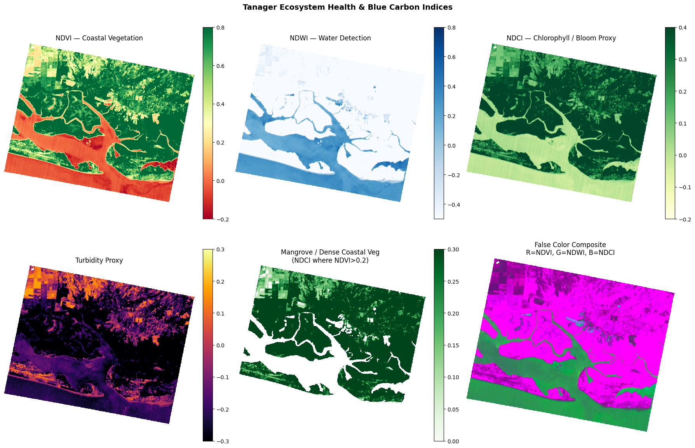

# GCC Mangrove Stress Radar & Blue Carbon Monitor

A reproducible proof-of-concept dashboard for detecting possible early mangrove stress and supporting field verification across the GCC.

**Team:** TAIF  
**Theme:** Ecosystem Health & Biodiversity / Blue Carbon  
**Challenge:** Arab Youth Space Hackathon — 813 Challenge

## 1. Business use case

The intended users are environmental protection agencies, coastal managers, marine conservation organizations, and blue-carbon project developers.

The dashboard supports:

- Prioritizing mangrove conservation and restoration sites
- Identifying areas requiring field or UAV inspection
- Monitoring possible vegetation stress
- Supporting blue-carbon monitoring and reporting

The current alternative is often a combination of expensive field surveys and manual satellite-image review. This proof of concept provides a faster regional screening workflow.

## 2. Problem

Mangroves are important blue-carbon ecosystems that store carbon, protect coastlines, and provide habitat for marine life. Stress from coastal development, pollution, storms, and climate change may appear before visible habitat loss.

This project explores whether satellite-derived vegetation and water indicators can identify possible emerging stress signals for field verification. The indicators are screening signals, not confirmed ecological diagnoses.

## 3. Data used

### Sentinel-2 Level-2A

- Provider: Copernicus Data Space / Microsoft Planetary Computer
- Product: Sentinel-2 Level-2A surface reflectance
- Use: Preliminary NDVI and NDWI comparison
- Scenes: 2024 and 2025, tile 40RBN
- Bands: B03, B04, and B08 where available
- Processing: cloud, shadow, cirrus, nodata, and invalid-pixel masking

### Planet Tanager hyperspectral data

- Provider: Planet / Microsoft Planetary Computer STAC
- Collection: `coastal-water-bodies`
- Scene: `20250223_165546_32_4001`
- Use: Exploratory hyperspectral spectral inspection and ecological proxies
- Approximate spectral range: 376–2499 nm
- Approximate spatial resolution: 32.85 m
- Quality information: cloud, cirrus, and nodata masks

### Global Mangrove Watch 2020

- Dataset: Global Mangrove Watch 2020
- Use: Reference mangrove extent and analysis mask
- Processing: reprojected to the Sentinel-2 analysis grid

The repository uses exact scene identifiers and download parameters in [data/sample_input/README.md](data/sample_input/README.md). Remote data access requires an internet connection. No credentials are stored in this repository.

## 4. Technical approach

The workflow runs in this order:

1. Load the fixed Planet Tanager item and inspect hyperspectral reflectance.
2. Apply Tanager cloud, cirrus, nodata, and invalid-pixel masks.
3. Calculate exploratory NDVI, NDWI, NDCI, and turbidity proxies from selected wavelengths.
4. Load the fixed Sentinel-2 Level-2A scenes from tile 40RBN.
5. Apply Sentinel-2 validity and scene-classification masks.
6. Calculate NDVI and NDWI for comparable dates.
7. Download and reproject Global Mangrove Watch 2020 onto the Sentinel-2 grid.
8. Calculate change statistics only inside the reference mangrove area.
9. Export summary files and dashboard points.
10. Display the prepared outputs in the Streamlit/Folium dashboard.

A negative NDVI change is interpreted as a possible stress signal requiring field verification. It is not a confirmed degradation or carbon-loss classification.

## 5. Installation

Requires Python 3.11.

```bash
git clone https://github.com/wadmd27-dotcom/mangrove-dashboard.git
cd mangrove-dashboard

python -m venv .venv
source .venv/bin/activate
# Windows:
# .venv\Scripts\activate

pip install -r requirements.txt
```

For Linux environments that need GDAL/PROJ system libraries, install the packages listed in [packages.txt](packages.txt) before installing Python dependencies.

## 6. How to run

### Reproduce the analysis

Open the notebook:

```bash
jupyter lab mangrove_stress_radar_memory_safe_fixed.ipynb
```

Run all cells from top to bottom with a fresh kernel. The notebook downloads the documented remote inputs, calculates the indicators, displays the analysis outputs, and writes the exported analysis files.

The first run may take several minutes because it downloads the Global Mangrove Watch archive and remote satellite assets. A normal run requires an internet connection and no GPU.

### Run the dashboard

```bash
streamlit run app.py
```

The dashboard reads the prepared files in `images/` and opens locally at `http://localhost:8501`.

The deployed proof-of-concept is available at:

[https://mangrove-dashboard-gwzy5ahspfkk7ves5299qj.streamlit.app/](https://mangrove-dashboard-gwzy5ahspfkk7ves5299qj.streamlit.app/)

## 7. Example input and output

The exact sample scenes and reference data are documented in [data/sample_input/README.md](data/sample_input/README.md).

The committed example output is:



The dashboard data files are stored in [images/](images/), including the sampled mangrove points, reference extent, analysis metadata, and UAE index summary.

## 8. Results and limitations

The proof of concept provides:

- Interactive GCC mangrove reference points
- Global Mangrove Watch 2020 reference information
- Preliminary UAE NDVI and NDWI indicators
- Possible mangrove stress signals
- Suggested locations for field or UAV inspection
- Exploratory Planet Tanager spectral proxies

Limitations:

- The results are preliminary indicators, not confirmed degradation.
- Global Mangrove Watch 2020 is a reference layer, not current ground truth.
- Cloud, shadow, tide, season, atmosphere, and sensor differences may affect the indicators.
- Planet Tanager outputs are exploratory and require additional validation.
- Field observations, UAV imagery, or known disturbance events are required for formal validation.
- Carbon stock, biodiversity, and coastal-protection values are not estimated directly in this proof of concept.
- The current country-specific numerical comparison is limited to the UAE.

## 9. Team, licence, and attribution

**Team:** TAIF

**Roles:** satellite-data processing, reproducibility and notebook development, dashboard development, and presentation.

This project was developed for the Arab Youth Space Hackathon 813 Challenge.

Data and platform attribution:

- Sentinel-2 Level-2A: Copernicus Data Space / Microsoft Planetary Computer
- Planet Tanager: Planet / Microsoft Planetary Computer STAC
- Global Mangrove Watch 2020: Global Mangrove Watch
- Dashboard framework: Streamlit and Folium

Users must follow the terms, licences, and attribution requirements of each data provider. The project code is provided as a proof of concept for hackathon evaluation.

## 10. Repository structure

```text
mangrove-dashboard/
├── README.md
├── requirements.txt
├── packages.txt
├── app.py
├── mangrove_stress_radar_memory_safe_fixed.ipynb
├── data/
│   └── sample_input/
│       └── README.md
├── images/
│   ├── gcc_mangrove_analysis_points.geojson
│   ├── gmw_uae_extent.geojson
│   ├── uae_indices_summary.json
│   └── mangrove_bg.jpg
└── results/
    └── example_output.png
```
